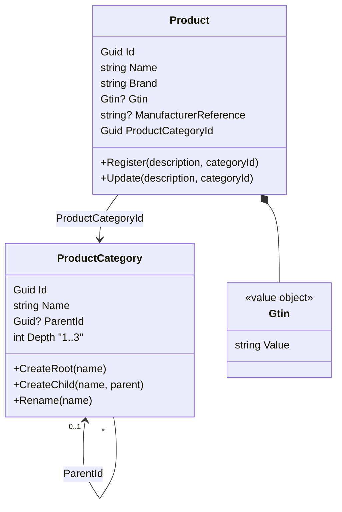
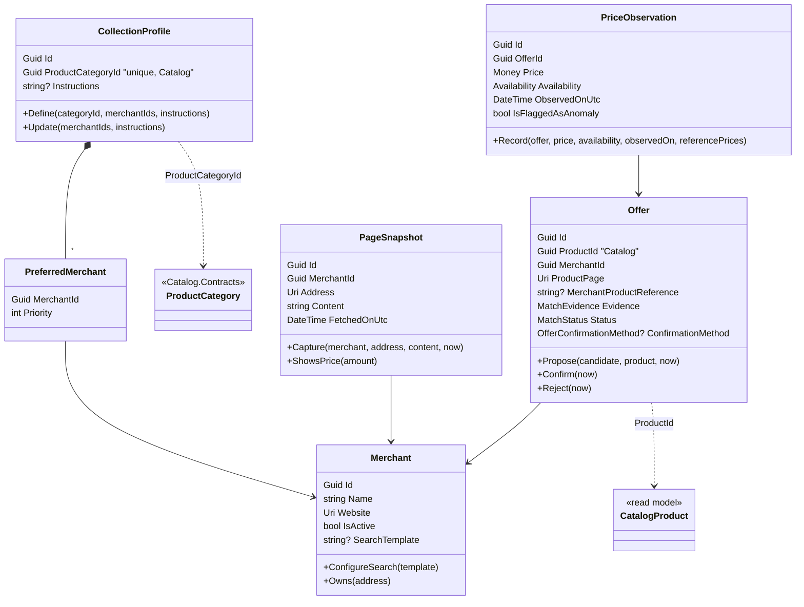
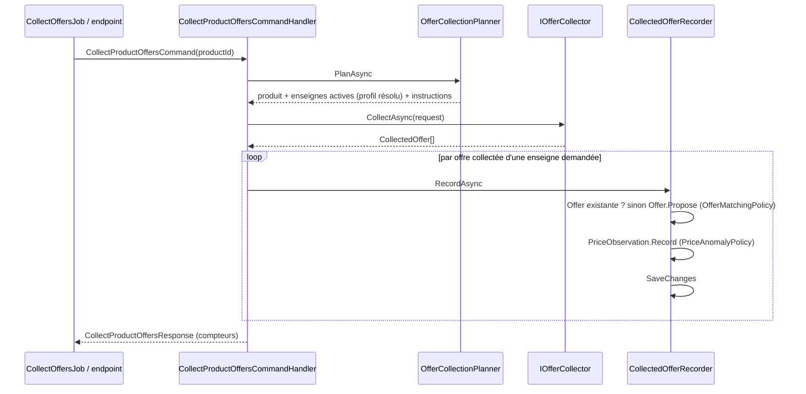

# Modèle

## Catalog (schéma `catalog`)

Événements publiés : `ProductCategoryCreated`, `ProductCategoryRenamed`, `ProductRegistered`, `ProductUpdated`.

## Pricing (schéma `pricing`)

Flèches pointillées : identifiants d'un autre module, sans clé étrangère. `CatalogProduct` est une copie locale (événements de Catalog) ; `ProductCategory` n'est pas copiée : Pricing la lit chez Catalog par son contrat (ADR-022).

## Flux de collecte

